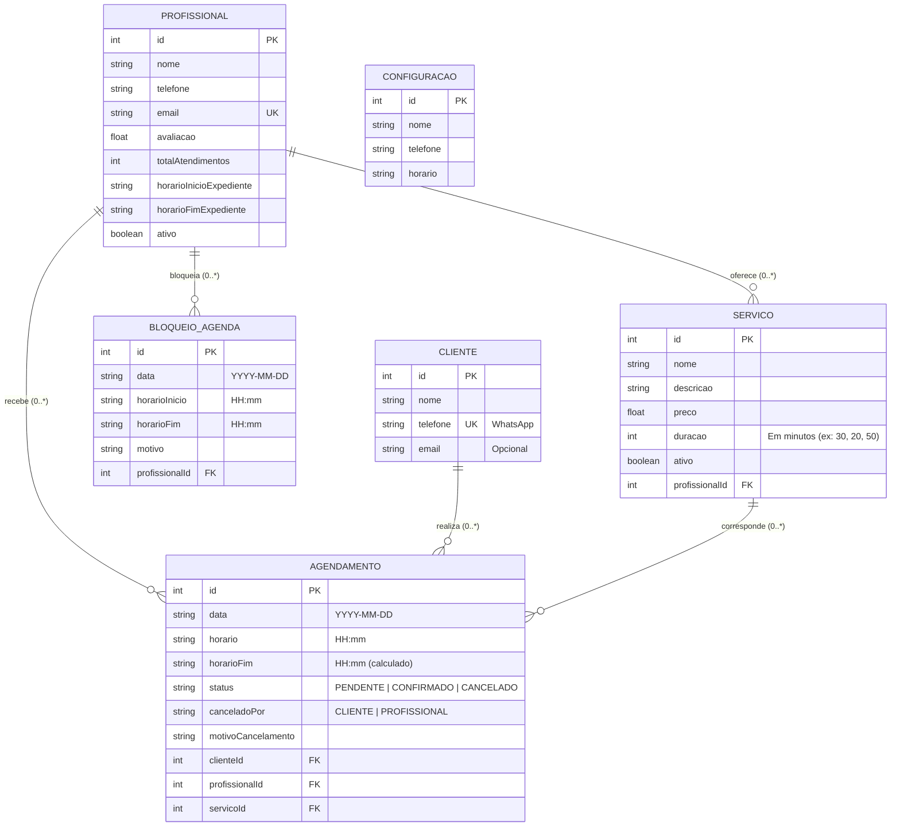

# HoraCerta - Backend & Banco de Dados

Backend e modelagem de banco de dados do sistema **HoraCerta** (*Sistema de Agendamento para Pequeno Comércio*), desenvolvido em **Node.js + TypeScript + Express + Prisma ORM (SQLite/PostgreSQL)**.

* **Equipe:** Michel Vieira, Hugo Braga, Pedro Henrique, Luan Azevedo, Hugo Ferreira
* **Porta padrão da API:** `http://localhost:3333` (CORS já liberado para integração com o Frontend)

---

## 1. Como Rodar na sua Máquina (Guia Rápido para a Equipe)

Pré-requisito: ter o **Node.js** instalado.

```bash
# 1. Entrar na pasta do backend
cd backend

# 2. Instalar as dependências
npm install

# 3. Criar o banco de dados SQLite local e popular com os dados do protótipo (Lucas, Rafael, Carlos, Serviços e Agenda)
npm run setup

# 4. Iniciar o servidor em modo desenvolvimento (http://localhost:3333)
npm run dev
```

### Outros comandos úteis:
* `npm test` — Executa os testes automatizados de **RF01 a RF05**, relatórios e configurações.
* `npm run db:studio` — Abre um painel visual no navegador (Prisma Studio) para ver e editar as tabelas do banco.
* `npm run db:seed` — Reseta o banco de dados para os dados originais do protótipo do PDF.

---

## 2. Guia de Integração para o Frontend (Mapeado Tela por Tela do Protótipo)

Abaixo está o guia exato de qual rota chamar em cada tela do protótipo do PDF, com exemplos de `fetch` prontos para copiar e colar:

### 📱 Tela 1 — Catálogo de Serviços (`Escolha um serviço`)
Lista todos os serviços ativos com nome, descrição, preço (`R$`) e duração (`minutos`).

* **Rota:** `GET http://localhost:3333/api/servicos`
* **Exemplo no Frontend:**
  ```javascript
  const res = await fetch('http://localhost:3333/api/servicos');
  const servicos = await res.json();
  ```
* **Resposta JSON (200 OK):**
  ```json
  [
    {
      "id": 1,
      "nome": "Corte Masculino",
      "descricao": "Corte social ou degradê na máquina e tesoura com finalização.",
      "preco": 40,
      "duracao": 30,
      "ativo": true
    },
    {
      "id": 2,
      "nome": "Barba",
      "descricao": "Modelagem completa de barba com toalha quente e navalha.",
      "preco": 30,
      "duracao": 20,
      "ativo": true
    },
    {
      "id": 3,
      "nome": "Corte + Barba",
      "descricao": "Combo completo de corte masculino e barba alinhada.",
      "preco": 65,
      "duracao": 50,
      "ativo": true
    }
  ]
  ```

---

### 📱 Tela 2 (Passo 1) — Escolha o Profissional
Lista os barbeiros/profissionais ativos com nota de avaliação e total de atendimentos.

* **Rota:** `GET http://localhost:3333/api/profissionais`
* **Exemplo no Frontend:**
  ```javascript
  const res = await fetch('http://localhost:3333/api/profissionais');
  const profissionais = await res.json();
  ```
* **Resposta JSON (200 OK):**
  ```json
  [
    {
      "id": 1,
      "nome": "Lucas Almeida",
      "telefone": "(11) 98888-0001",
      "email": "lucas@horacerta.com.br",
      "avaliacao": 4.9,
      "totalAtendimentos": 128,
      "horarioInicioExpediente": "08:00",
      "horarioFimExpediente": "18:00"
    },
    {
      "id": 2,
      "nome": "Rafael Souza",
      "avaliacao": 4.8,
      "totalAtendimentos": 96
    },
    {
      "id": 3,
      "nome": "Carlos Mendes",
      "avaliacao": 4.7,
      "totalAtendimentos": 74
    }
  ]
  ```

---

### 📱 Tela 2 (Passo 2) — Escolha a Data e o Horário Disponível (**RF02 / RF04**)
Retorna os horários livres do profissional na data escolhida, bloqueando automaticamente os horários ocupados e levando em conta a duração do serviço selecionado.

* **Rota:** `GET http://localhost:3333/api/profissionais/:id/disponibilidade?data=YYYY-MM-DD&servicoId=X`
* **Exemplo no Frontend:**
  ```javascript
  const profissionalId = 1;
  const servicoId = 1;
  const data = '2025-11-12';

  const res = await fetch(
    `http://localhost:3333/api/profissionais/${profissionalId}/disponibilidade?data=${data}&servicoId=${servicoId}`
  );
  const { horariosDisponiveis, gradeCompleta } = await res.json();
  ```
* **Resposta JSON (200 OK):**
  ```json
  {
    "profissional": {
      "id": 1,
      "nome": "Lucas Almeida",
      "expediente": "08:00 - 18:00"
    },
    "data": "2025-11-12",
    "servico": {
      "id": 1,
      "nome": "Corte Masculino",
      "duracao": 30,
      "preco": 40
    },
    "horariosDisponiveis": ["08:00", "08:30", "09:00", "09:30", "10:30", "11:30", "12:00"],
    "gradeCompleta": [
      { "horario": "09:30", "horarioFim": "10:00", "disponivel": true },
      {
        "horario": "10:00",
        "horarioFim": "10:30",
        "disponivel": false,
        "motivoIndisponibilidade": "Conflito com atendimento das 10:00 às 10:20"
      }
    ]
  }
  ```

---

### 📱 Tela 2 (Passo 3) — Confirmar Agendamento (`Seus dados`) (**RF02 / RF04**)
Envia o agendamento com `Nome completo` e `Telefone (WhatsApp)`. O backend cadastra/atualiza o cliente automaticamente e trava o horário no banco de dados. Se outro cliente tiver acabado de ocupar o mesmo horário, retorna erro `409 Conflict`.

* **Rota:** `POST http://localhost:3333/api/agendamentos`
* **Exemplo no Frontend:**
  ```javascript
  const res = await fetch('http://localhost:3333/api/agendamentos', {
    method: 'POST',
    headers: { 'Content-Type': 'application/json' },
    body: JSON.stringify({
      profissionalId: 1,
      servicoId: 1,
      data: '2025-11-12',
      horario: '14:30',
      cliente: {
        nome: 'João Silva',
        telefone: '(11) 99999-1234'
      }
    })
  });
  const dados = await res.json();
  ```
* **Resposta JSON (201 Created):**
  ```json
  {
    "mensagem": "Agendamento confirmado! Seu horário foi reservado com sucesso.",
    "agendamento": {
      "id": 5,
      "data": "2025-11-12",
      "horario": "14:30",
      "horarioFim": "15:00",
      "status": "CONFIRMADO",
      "cliente": { "id": 1, "nome": "João Silva", "telefone": "(11) 99999-1234" },
      "profissional": { "id": 1, "nome": "Lucas Almeida" },
      "servico": { "id": 1, "nome": "Corte Masculino", "preco": 40, "duracao": 30 }
    }
  }
  ```

---

### 📱 Tela 4 — Sucesso / Comprovante (`Cancelar agendamento`) (**RF05**)
Permite que o cliente (ou o profissional no painel) cancele o agendamento. Assim que cancelado, o horário volta automaticamente a ficar disponível na agenda!

* **Rota:** `PATCH http://localhost:3333/api/agendamentos/:id/cancelar`
* **Exemplo no Frontend:**
  ```javascript
  await fetch(`http://localhost:3333/api/agendamentos/${agendamentoId}/cancelar`, {
    method: 'PATCH',
    headers: { 'Content-Type': 'application/json' },
    body: JSON.stringify({
      canceladoPor: 'CLIENTE', // ou 'PROFISSIONAL'
      motivoCancelamento: 'Imprevisto pessoal'
    })
  });
  ```

---

### 💻 Tela 3 — Dashboard e Agenda (Visão Profissional / Dono)

#### A. Carregar Grade da Agenda (Dia, Semana ou Mês) (**RF03**)
* **Rota:** `GET http://localhost:3333/api/profissionais/:id/agenda?dataInicio=2025-11-10&dataFim=2025-11-16`
* **Exemplo no Frontend:**
  ```javascript
  const res = await fetch(
    'http://localhost:3333/api/profissionais/1/agenda?dataInicio=2025-11-10&dataFim=2025-11-16'
  );
  const { resumo, agendamentos, bloqueios } = await res.json();
  ```
* **Resposta JSON (200 OK):**
  * `resumo`: `{ total: 4, confirmados: 3, pendentes: 1, cancelados: 0, faturamentoPrevisto: 175 }`
  * `agendamentos`: Lista ordenada por data e horário contendo `cliente`, `servico` e `status` (`CONFIRMADO`, `PENDENTE`, `CANCELADO`).
  * `bloqueios`: Lista de horários bloqueados manualmente pelo profissional.

#### B. Confirmar um Agendamento Pendente no Painel
* **Rota:** `PATCH http://localhost:3333/api/agendamentos/:id/confirmar`
  ```javascript
  await fetch(`http://localhost:3333/api/agendamentos/${agendamentoId}/confirmar`, {
    method: 'PATCH'
  });
  ```

#### C. Cadastrar e Editar Serviços no Menu "Serviços" (**RF01**)
* **Cadastrar (`POST http://localhost:3333/api/servicos`):**
  ```javascript
  await fetch('http://localhost:3333/api/servicos', {
    method: 'POST',
    headers: { 'Content-Type': 'application/json' },
    body: JSON.stringify({
      nome: 'Sobrancelha',
      descricao: 'Limpeza e alinhamento na navalha',
      preco: 15.0,
      duracao: 15
    })
  });
  ```
* **Editar (`PUT http://localhost:3333/api/servicos/:id`):**
  ```javascript
  await fetch(`http://localhost:3333/api/servicos/${servicoId}`, {
    method: 'PUT',
    headers: { 'Content-Type': 'application/json' },
    body: JSON.stringify({ preco: 45.0, duracao: 35 })
  });
  ```

#### D. Bloquear Horários Manualmente no Menu "Bloquear horários"
* **Criar Bloqueio (`POST http://localhost:3333/api/bloqueios`):**
  ```javascript
  await fetch('http://localhost:3333/api/bloqueios', {
    method: 'POST',
    headers: { 'Content-Type': 'application/json' },
    body: JSON.stringify({
      profissionalId: 1,
      data: '2025-11-12',
      horarioInicio: '12:00',
      horarioFim: '13:00',
      motivo: 'Horário de almoço'
    })
  });
  ```
* **Remover Bloqueio (`DELETE http://localhost:3333/api/bloqueios/:id`)**

#### E. Consultar Relatórios
* **Rota:** `GET http://localhost:3333/api/relatorios?dataInicio=2025-11-01&dataFim=2025-11-30`
* Os filtros `dataInicio`, `dataFim` e `status` são opcionais. A resposta inclui o resumo dos agendamentos, faturamento previsto e os registros do período.

#### F. Consultar e Atualizar Configurações
* **Consultar:** `GET http://localhost:3333/api/configuracoes`
* **Atualizar:** `PUT http://localhost:3333/api/configuracoes`
  ```javascript
  await fetch('http://localhost:3333/api/configuracoes', {
    method: 'PUT',
    headers: { 'Content-Type': 'application/json' },
    body: JSON.stringify({
      nome: 'Barbearia HoraCerta',
      telefone: '(11) 99999-0000',
      horario: '08:00-18:00'
    })
  });
  ```

---

## 3. Diagrama Entidade-Relacionamento (DER)



---

## 4. Estrutura de Arquivos do Projeto

```text
horacerta-backend/
├── database/
│   ├── schema.sql                # Script SQL DDL puro (Tabelas, FKs, Constraints e Índices)
│   └── seed.sql                  # Script SQL DML com os dados do protótipo de telas
├── prisma/
│   └── schema.prisma             # Modelagem Prisma ORM (SQLite local / pronto p/ PostgreSQL)
├── src/
│   ├── __tests__/
│   │   └── api.test.ts           # Testes automatizados cobrindo RF01 a RF05
│   ├── config/
│   │   └── prisma.ts             # Instância de conexão com o banco
│   ├── controllers/
│   │   ├── ServicoController.ts       # RF01: Cadastrar, editar e listar serviços
│   │   ├── ProfissionalController.ts  # RF02, RF03, RF04: Disponibilidade e Agenda
│   │   ├── AgendamentoController.ts   # RF02, RF03, RF04, RF05: Agendar, confirmar, cancelar
│   │   ├── BloqueioController.ts      # Caso de Uso: Bloquear horários ocupados
│   │   ├── ClienteController.ts       # Consulta de clientes e histórico
│   │   ├── RelatorioController.ts     # Resumo e listagem de agendamentos
│   │   └── ConfiguracaoController.ts  # Leitura e atualização das configurações
│   ├── routes/
│   │   └── index.ts              # Definição das rotas da API REST
│   ├── services/
│   │   └── DisponibilidadeService.ts  # Algoritmo de cálculo de horários e prevenção de choques (RF04)
│   ├── app.ts                    # Configuração Express e middlewares
│   ├── seed.ts                   # Popula o banco com os dados das telas do PDF
│   └── server.ts                 # Inicialização do servidor HTTP (porta 3333)
├── package.json
└── tsconfig.json
```
