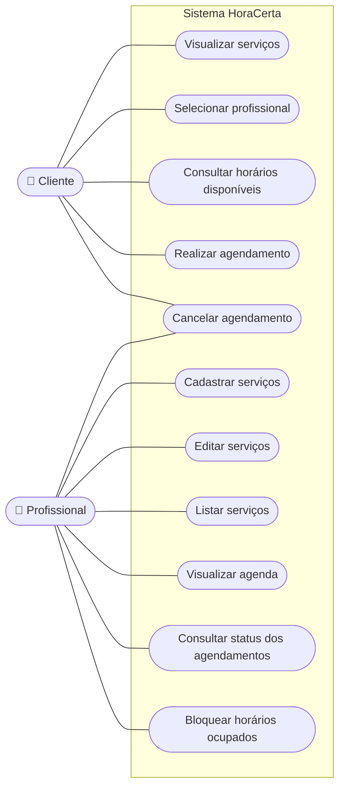
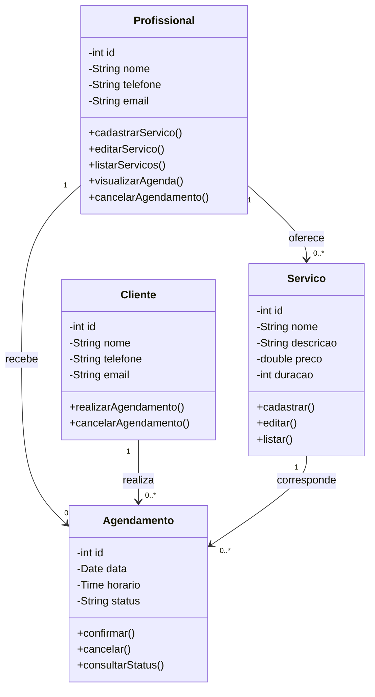

# Documentação de Modelagem UML — HoraCerta

Este documento apresenta a modelagem arquitetural e comportamental do sistema **HoraCerta**, elaborada utilizando a linguagem **UML (Unified Modeling Language)** por meio da sintaxe **Mermaid**. Os diagramas aqui documentados refletem diretamente os requisitos levantados e a estrutura implementada no código-fonte.

---

## 1. Diagrama de Casos de Uso

O **Diagrama de Casos de Uso** ilustra as interações entre os atores externos e as funcionalidades internas oferecidas pelo sistema **HoraCerta**.

### 1.1 Atores Identificados
* **Cliente:** Usuário externo que acessa a interface pública para consultar serviços, escolher um profissional, verificar horários disponíveis, realizar agendamentos e cancelar reservas.
* **Profissional:** Prestador de serviço ou administrador do estabelecimento que gerencia o catálogo de serviços (cadastrar, editar, listar), acompanha a agenda, consulta o status dos atendimentos, realiza bloqueios de horários e pode cancelar agendamentos.

### 1.2 Representação Visual (Mermaid)

### 1.3 Descrição dos Casos de Uso

| Caso de Uso | Ator(es) | Descrição Sucinta | Requisito Relacionado |
| :--- | :--- | :--- | :--- |
| **Visualizar serviços** | Cliente | Exibe a lista pública de serviços ativos com seus respectivos preços e durações estimadas. | RF01, RF02 |
| **Selecionar profissional** | Cliente | Permite ao cliente escolher qual profissional realizará o atendimento desejado. | RF02 |
| **Consultar horários disponíveis** | Cliente | Verifica a disponibilidade na agenda do profissional selecionado para uma data específica, ocultando horários ocupados ou bloqueados. | RF02, RF04 |
| **Realizar agendamento** | Cliente | Registra a reserva vinculando cliente, profissional, serviço, data e horário escolhidos. | RF02, RF04 |
| **Cancelar agendamento** | Cliente, Profissional | Altera o status de um agendamento para cancelado, liberando o horário na grade de disponibilidade. | RF05 |
| **Cadastrar / Editar / Listar serviços** | Profissional | Operações de gerenciamento do catálogo de serviços oferecidos pelo estabelecimento. | RF01 |
| **Visualizar agenda / Consultar status** | Profissional | Permite acompanhar os atendimentos marcados na grade diária/semanal e verificar o histórico/status (Confirmado, Pendente, Cancelado). | RF03 |
| **Bloquear horários ocupados** | Profissional | Permite ao prestador bloquear manualmente faixas de horário na agenda para compromissos pessoais ou folgas. | RF03, RF04 |

---

## 2. Diagrama de Classes

O **Diagrama de Classes** representa a estrutura estática do domínio da aplicação, detalhando as entidades principais, seus atributos, tipos de dados, métodos operacionais e multiplicidades de relacionamento.

### 2.1 Representação Visual (Mermaid)

### 2.2 Detalhamento das Classes e Relacionamentos

* **`Profissional` (`1` para `0..*` `Servico`):** Um profissional pode cadastrar e oferecer zero ou vários serviços no catálogo.
* **`Profissional` (`1` para `0..*` `Agendamento`):** Um profissional recebe zero ou vários agendamentos em sua grade de horários.
* **`Cliente` (`1` para `0..*` `Agendamento`):** Um cliente pode realizar zero ou vários agendamentos ao longo do tempo.
* **`Servico` (`1` para `0..*` `Agendamento`):** Cada agendamento está vinculado a um serviço específico, o qual determina o valor cobrado e o tempo de duração necessário na agenda para a trava anti-conflito.